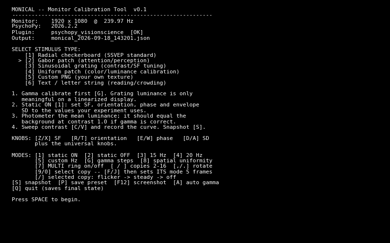
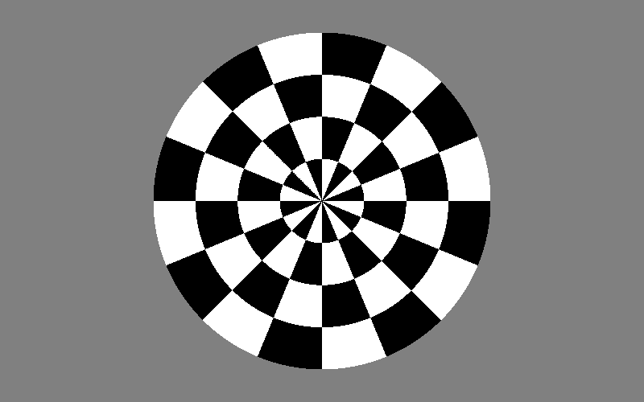
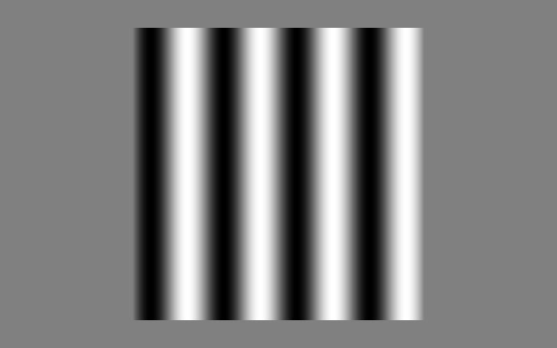
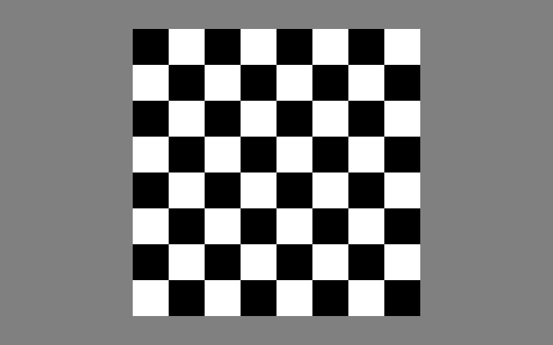
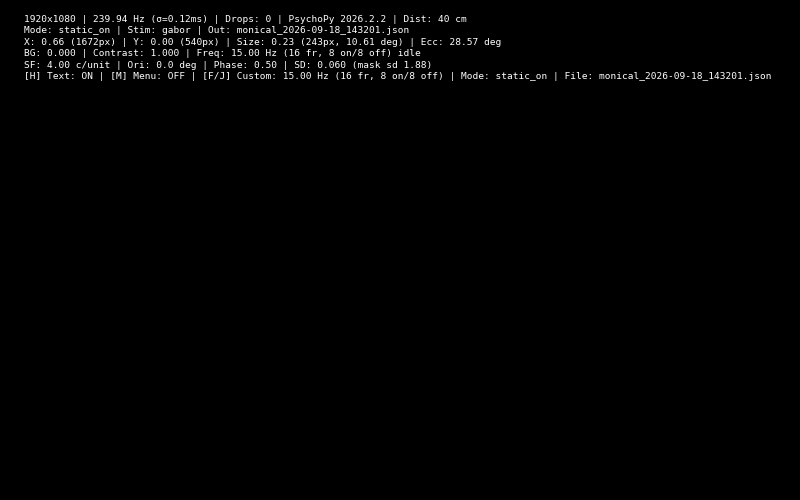

# Monical

Keyboard-driven monitor calibration for vision science: renders standard stimuli with every parameter adjustable live, and exports the values you measure to JSON.



## Install

PsychoPy is the only requirement. `psychopy_visionscience` is optional and needed only for the radial checkerboard:

```bash
pip install psychopy-visionscience
```

## Run

```bash
python monical.py
python monical.py --image assets/texture.png
python monical.py --preset presets/preset_2026-09-18_143201.json
python monical.py --text "MYSTRING"   # strings for the text stimulus
python monical.py --bench     # frame-timing benchmark for this rig, fullscreen
```

Pick a stimulus type with `1`–`6`, press `SPACE`. No config files, no build step. Each session writes its own `monical_YYYY-MM-DD_HHMMSS.json` beside the script.

## Stimulus types

| | |
|---|---|
| **Radial checkerboard** — SSVEP standard dartboard. Rings and wedges adjustable; defaults (4 rings, 16 wedges) are pixel-identical to the original construction. | **Gabor patch** — sinusoidal carrier under a Gaussian envelope. SF, orientation, phase, envelope SD. |
|  |  |
| **Sinusoidal grating** — the same carrier, no envelope; sin, square or sawtooth, optional circular mask. Contrast sensitivity, SF tuning. | **Uniform patch** — per-channel R/G/B and alpha, rect or circle (shown: green channel isolated). |
|  |  |
| **Custom PNG** — your own texture via `--image`, rotatable. Without it, this generated 8×8 checkerboard. | **Text / letter string** — letters and strings for legibility and acuity checks: three font families, letter spacing, rotation. Cycle with `B`/`N`, or pass `--text`. |
|  |  |

The previews are schematic renders made by [tools/generate_previews.py](tools/generate_previews.py), not screen captures. Read real parameter values off the readout.

## Modes

`1` static ON · `2` static OFF · `3` flicker 15 Hz · `4` flicker 20 Hz · `5` flicker at the custom rate · `G` gamma steps (11 levels) · `8` spatial uniformity (3×3 grid) · `7` toggles N copies (2–16) on a ring through the stimulus position; N = 2 is the ±X pair

Flicker is driven by integer frame counts, so the readout always reports the **realized** frequency, never the requested one.

## Keys

| | |
|---|---|
| Arrows | move the stimulus, X/Y ±0.005 |
| `PAGEUP`/`PAGEDN` | background gray ±0.001 |
| `+`/`-` | size ±0.01 |
| `C`/`V` | contrast ±0.001 |
| `F`/`J` | custom flicker (mode 5) ±1 frame, so every press is a new realized rate |
| `;`/`'` | viewing distance ±1 cm |
| `[`/`]` · `,`/`.` · `9`/`0` | multi-stimulus ring: copies 2–16 · rotate ±5° · select a copy (its own mode 5 frames via `F`/`J`) |
| `/` | multi: selected copy flicker → steady → off |
| `Z/X` `R/T` `E/W` `D/A` | stimulus-specific: Gabor/grating SF, orientation, phase, SD (grating: waveform); uniform/text alpha, red, green, blue |
| `Z/X` / `R/T` | radial only: rings ±1 (1–20) / wedges ±2 (2–32) |
| `D/A` / `B` | grating only: waveform sin/sqr/saw / circular mask on-off |
| `B` | uniform only: rect / circle |
| `Z/X` / `R/T` | custom PNG only: alpha ±0.01 / rotation ±5° |
| `I/O` `U/Y` `K/L` | text only: font family / letter spacing ±0.001 / rotation ±5° |
| `S` / `Q` or `ESC` | snapshot / quit and save (`ESC` first cancels a running sweep or closes the menu) |
| `P` / `F12` | save preset / save screenshot PNG |
| `A` | gamma mode only: automatic 11-level sweep, 2 s per level |
| `H` | show/hide the readout (stimulus keeps rendering) |
| `B`/`N` | text type only: cycle strings (`ABCDEF`, `abcdef`, `123456`, `XXXXXX`, `oOoOoO`, or built from `--text`) |
| `M` | keybinding reference card for the current stimulus type |

Position, background, contrast, the color channels, text letter spacing and custom flicker frames auto-repeat at ~60/s after a 1-second hold. Full table in [docs/MANUAL.md](docs/MANUAL.md#4-keybindings).

## Readout



Five lines, updated every frame: measured refresh with frame-interval σ and a dropped-frame counter, mode and output filename, geometry in both degrees and pixels, luminance and realized flicker rate with its on/off frame split, then the active stimulus parameters. `H` hides it.

Below that, a dimmer status bar that **never hides** — toggle states, the custom flicker rate and frames with their keys, the mode, and the output file. `M` overlays a full keybinding card for the current stimulus type.

The refresh figure is a rolling 120-frame average of real flip-to-flip intervals, not the startup measurement — if the two disagree by more than 5 Hz the tool says so, because every flicker frame count depends on getting it right.

## Output

`monical_YYYY-MM-DD_HHMMSS.json`, rewritten on every snapshot and on quit. One file per session — nothing is ever overwritten.

```json
{
  "note": "REFERENCE ONLY. Not loaded by any experiment. Values are read by humans and entered manually.",
  "session_start": "2026-08-21T14:30:12",
  "session_end": "2026-08-21T14:47:03",
  "monical_version": "0.1",
  "monitor_name": "testMonitor",
  "monitor_resolution": [1920, 1080],
  "monitor_width_cm": 58.67,
  "monitor_height_cm": 33.0,
  "monitor_dimension_warning": false,
  "color_space": "rgb",
  "units": "height",
  "window_fullscreen": true,
  "vsync": true,
  "vsync_detail": {
    "wait_blanking": true,
    "pyglet_vsync": true,
    "context_get_vsync": false
  },
  "startup_refresh_hz": 239.97,
  "final_rolling_refresh_hz": 239.94,
  "final_rolling_refresh_sd_ms": 0.1203,
  "total_dropped_frames": 0,
  "psychopy_version": "2026.2.2",
  "python_version": "3.11.0 ...",
  "platform": "win32",
  "has_radial_stim": true,
  "image_path": null,
  "image_load_failed": false,
  "text_arg": null,
  "preset_path": null,
  "output_file": "monical_2026-08-21_143012.json",
  "viewing_distance_cm": 40.0,
  "stimulus_type": "radial_checkerboard",
  "snapshots": [
    {
      "snapshot_number": 1,
      "timestamp": "2026-08-21T14:32:01",
      "rolling_refresh_hz": 239.94,
      "dropped_frames_total": 0,
      "stimulus_type": "radial_checkerboard",
      "mode": "static_on",
      "dual_stimulus": false,
      "multi_active": false,
      "multi_count": 2,
      "ring_offset_deg": 0.0,
      "ring_radius": 0.66,
      "ring_center_y": 0.0,
      "selected_index": 0,
      "stimuli": [
        {"index": 0, "x": 0.66, "y": 0.0, "ecc_deg": 28.57,
         "flicker_frames": 16, "on_frames": 8, "off_frames": 8,
         "realized_hz": 14.998, "flicker_state": "flicker",
         "offscreen": false}
      ],
      "x_position": 0.66,
      "y_position": 0.0,
      "background_gray": 0.012,
      "disc_size": 0.225,
      "contrast": 1.0,
      "custom_frequency_hz": 14.998,
      "visual_angle_deg": 10.61,
      "eccentricity_deg": 28.57,
      "stimulus_specific": {
        "rings": 4,
        "wedges": 16,
        "radialCycles": 2.0,
        "angularCycles": 8.0,
        "radialPhase": 0.25
      },
      "flicker_active": false,
      "flicker_frames": 16,
      "flicker_on_frames": 8,
      "flicker_off_frames": 8,
      "flicker_realized_hz": 14.998,
      "refresh_hz_used": 239.97
    }
  ],
  "final": { ... }
}
```

Alongside the parameters, each session records the rig it was measured on — resolution, physical size, units, color space, vsync state, PsychoPy and Python versions — so the numbers stay interpretable later. Snapshots carry the rolling refresh rate and drop count at the moment they were taken, so you can tell whether timing was healthy for that reading.

Nothing reads this file back. You transcribe the values into your experiment by hand.

## Documentation

- [docs/MANUAL.md](docs/MANUAL.md) — operating manual: full keybindings, nine step-by-step workflows, output reference, troubleshooting.
- [docs/PRD.md](docs/PRD.md) — design authority: what each stimulus is, why, and the exact construction.
- [docs/VERIFICATION.md](docs/VERIFICATION.md) — verification protocol: confirm the readout and JSON match what the display is physically doing.

## What it is not

Not an experiment, not a monitor profiler, not automatic. It does not build or apply gamma tables — PsychoPy Monitor Center does that; Monical helps you collect the measurements. No photodiode input, no closed loop, no mouse, no GUI widgets.

## Citing

If you use Monical in your research, please cite:

> Caruso, T. (2026). Monical: A keyboard-driven monitor calibration tool for vision science. https://github.com/trevcaru/monical

## Support

This tool is free and open-source, and will stay that way. If it saved you time or helped your lab, you can support maintenance:

- [Ko-fi (one-time tip)](https://ko-fi.com/trevcaru)

## License

MIT — see [LICENSE](LICENSE).
